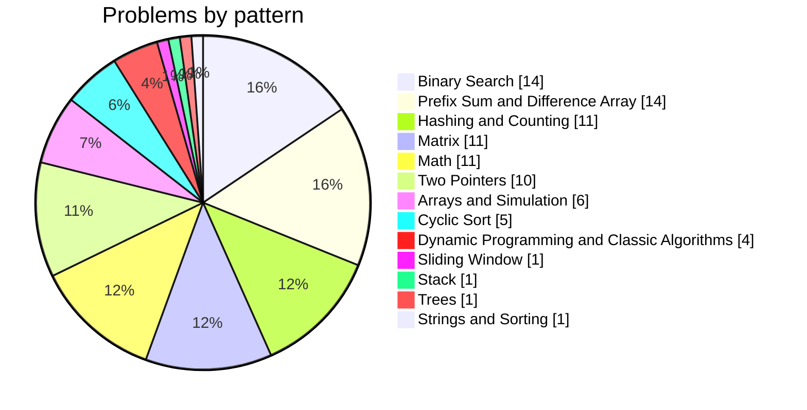

<div align="center">

# ☕ Data Structures & Algorithms in Java

### Clean, tested and documented LeetCode solutions, organised by problem-solving pattern

**Neha Karamchandani** · [@n3h4a](https://github.com/n3h4a)

<!-- Add your links here, e.g. · [LeetCode](https://leetcode.com/u/<your-username>/) · [LinkedIn](https://www.linkedin.com/in/<your-profile>/) -->

[](https://github.com/n3h4a/dsa-practise/actions/workflows/ci.yml)


[About](#about) · [Highlights](#highlights) · [At a Glance](#at-a-glance) · [Problems](#problems) · [Pattern Notes](./PATTERNS.md) · [Testing](#testing)

</div>

---

<a id="about"></a>

## 👋 About

This is where I practise data structures and algorithms. Instead of a flat list
sorted by problem number, the solutions are **grouped by the pattern behind
them**, because the skill I'm building is recognising *which technique fits a
problem*, not memorising answers.

Every solution:

- ✍️ starts with a header explaining the **approach** in plain English
- ⏱️ states its **time and space complexity**
- 🔁 lists the **earlier approaches I tried**, where I improved on a first version
- ✅ is **compiled on every push**, and many have **unit tests** covering edge cases

```java
/*
 * Two Sum
 * Pattern : Hashing
 * Approach: Single pass. For each number, check whether its complement
 *           (target - num) has already been seen. The map stores
 *           value -> index so the answer can be returned immediately.
 * Time    : O(n)
 * Space   : O(n)
 */
```

<a id="highlights"></a>

## ✨ Highlights

| | Topic | What to look at |
|:---:|---|---|
| 📈 | **Difference arrays & line sweep** | A full progression, from [Corporate Flight Bookings](./1206-corporate-flight-bookings/corporate-flight-bookings.java) and [Car Pooling](./1184-car-pooling/car-pooling.java) to [My Calendar III](./732-my-calendar-iii/my-calendar-iii.java) and [Zero Array Transformation II](./3643-zero-array-transformation-ii/zero-array-transformation-ii.java) (binary search on the answer + difference array) |
| 🔍 | **Binary search, every flavour** | Rotated arrays [with duplicates](./81-search-in-rotated-sorted-array-ii/search-in-rotated-sorted-array-ii.java), [mountain arrays](./1185-find-in-mountain-array/find-in-mountain-array.java), [peak finding](./162-find-peak-element/find-peak-element.java), [first/last position](./34-find-first-and-last-position-of-element-in-sorted-array/find-first-and-last-position-of-element-in-sorted-array.java), binary search on the answer |
| 🔄 | **Cyclic sort** | [First Missing Positive](./41-first-missing-positive/first-missing-positive.java) (Hard) in O(n) time and O(1) space |
| 🐢🐇 | **Floyd's cycle detection** | [Find the Duplicate Number](./287-find-the-duplicate-number/find-the-duplicate-number.java), which finds the duplicate without modifying the array |
| 🧠 | **DP + memoisation** | [Maximum Score of Non-overlapping Intervals](./3562-maximum-score-of-non-overlapping-intervals/maximum-score-of-non-overlapping-intervals.java) (Hard) |
| 📝 | **Iterating to the optimal answer** | [Majority Element](./169-majority-element/majority-element.java): O(n²) → HashMap → sort → Boyer-Moore O(1) space |

> 📘 My notes on each technique, covering when to use it and the code template I start from, are in **[PATTERNS.md](./PATTERNS.md)**.

<!-- PROBLEMS:START -->
<!-- Generated by scripts/generate_readme.py - do not edit by hand. -->

<a id="at-a-glance"></a>

## 📊 At a Glance

<div align="center">

| 🧩 Total | 🟢 Easy | 🟠 Medium | 🔴 Hard | 🗂️ Patterns |
|:---:|:---:|:---:|:---:|:---:|
| **90** | **58** | **27** | **5** | **13** |

</div>



<a id="problems"></a>

## 🗂️ Problems by Pattern

> Click a pattern to expand it. Every row links to the problem on LeetCode and to my solution.

<details>
<summary><b>🧱 Arrays & Simulation</b> &nbsp;—&nbsp; 6 problems &nbsp;(🟢 6)</summary>

| # | Problem | Difficulty | Technique | Time | Space | Code |
|:---:|---|---|---|---|---|:---:|
| 1 | [Build Array from Permutation](https://leetcode.com/problems/build-array-from-permutation) | 🟢 Easy | Array | `O(n)` | `O(n)` | [☕ Java](./2048-build-array-from-permutation/build-array-from-permutation.java) |
| 2 | [Concatenation of Array](https://leetcode.com/problems/concatenation-of-array) | 🟢 Easy | Array | `O(n)` | `O(n)` | [☕ Java](./2058-concatenation-of-array/concatenation-of-array.java) |
| 3 | [Count Items Matching a Rule](https://leetcode.com/problems/count-items-matching-a-rule) | 🟢 Easy | Array | `O(n)` | `O(1)` | [☕ Java](./1899-count-items-matching-a-rule/count-items-matching-a-rule.java) |
| 4 | [Create Target Array in the Given Order](https://leetcode.com/problems/create-target-array-in-the-given-order) | 🟢 Easy | Array Simulation | `O(n^2)` | `O(n)` | [☕ Java](./1505-create-target-array-in-the-given-order/create-target-array-in-the-given-order.java) |
| 5 | [Kids With the Greatest Number of Candies](https://leetcode.com/problems/kids-with-the-greatest-number-of-candies) | 🟢 Easy | Array | `O(n)` | `O(1)` | [☕ Java](./1528-kids-with-the-greatest-number-of-candies/kids-with-the-greatest-number-of-candies.java) |
| 6 | [Shuffle the Array](https://leetcode.com/problems/shuffle-the-array) | 🟢 Easy | Array | `O(n)` | `O(n)` | [☕ Java](./1580-shuffle-the-array/shuffle-the-array.java) |

</details>

<details>
<summary><b>#️⃣ Hashing & Counting</b> &nbsp;—&nbsp; 11 problems &nbsp;(🟢 10 · 🟠 1)</summary>

| # | Problem | Difficulty | Technique | Time | Space | Code |
|:---:|---|---|---|---|---|:---:|
| 1 | [Check if the Sentence Is Pangram](https://leetcode.com/problems/check-if-the-sentence-is-pangram) | 🟢 Easy | Hashing | `O(n)` | `O(1)` | [☕ Java](./1960-check-if-the-sentence-is-pangram/check-if-the-sentence-is-pangram.java) |
| 2 | [Contains Duplicate](https://leetcode.com/problems/contains-duplicate) | 🟢 Easy | Hashing | `O(n)` | `O(n)` | [☕ Java](./217-contains-duplicate/contains-duplicate.java) |
| 3 | [Contains Duplicate II](https://leetcode.com/problems/contains-duplicate-ii) | 🟢 Easy | Hashing | `O(n)` | `O(n)` | [☕ Java](./219-contains-duplicate-ii/contains-duplicate-ii.java) |
| 4 | [Finding 3-Digit Even Numbers](https://leetcode.com/problems/finding-3-digit-even-numbers) | 🟢 Easy | Counting / Enumeration | `O(n + 450)` | `O(1)` | [☕ Java](./2215-finding-3-digit-even-numbers/finding-3-digit-even-numbers.java) |
| 5 | [How Many Numbers Are Smaller Than the Current Number](https://leetcode.com/problems/how-many-numbers-are-smaller-than-the-current-number) | 🟢 Easy | Counting / Prefix Sum | `O(n + 101)` | `O(101)` | [☕ Java](./1482-how-many-numbers-are-smaller-than-the-current-number/how-many-numbers-are-smaller-than-the-current-number.java) |
| 6 | [Number of Good Pairs](https://leetcode.com/problems/number-of-good-pairs) | 🟢 Easy | Hashing / Counting | `O(n)` | `O(1)` | [☕ Java](./1635-number-of-good-pairs/number-of-good-pairs.java) |
| 7 | [Special Array With X Elements Greater Than or Equal X](https://leetcode.com/problems/special-array-with-x-elements-greater-than-or-equal-x) | 🟢 Easy | Counting / Prefix Sum | `O(n)` | `O(n)` | [☕ Java](./1730-special-array-with-x-elements-greater-than-or-equal-x/special-array-with-x-elements-greater-than-or-equal-x.java) |
| 8 | [Two Sum](https://leetcode.com/problems/two-sum) | 🟢 Easy | Hashing | `O(n)` | `O(n)` | [☕ Java](./1-two-sum/two-sum.java) |
| 9 | [Unique 3-Digit Even Numbers](https://leetcode.com/problems/unique-3-digit-even-numbers) | 🟢 Easy | Hashing / Enumeration | `O(n^3)` | `O(1)` | [☕ Java](./3799-unique-3-digit-even-numbers/unique-3-digit-even-numbers.java) |
| 10 | [Valid Anagram](https://leetcode.com/problems/valid-anagram) | 🟢 Easy | Hashing / Counting | `O(n)` | `O(1)` | [☕ Java](./242-valid-anagram/valid-anagram.java) |
| 11 | [Group Anagrams](https://leetcode.com/problems/group-anagrams) | 🟠 Medium | Hashing | `O(n * k log k)` | `O(n * k)` | [☕ Java](./49-group-anagrams/group-anagrams.java) |

</details>

<details>
<summary><b>👉 Two Pointers</b> &nbsp;—&nbsp; 10 problems &nbsp;(🟢 7 · 🟠 3)</summary>

| # | Problem | Difficulty | Technique | Time | Space | Code |
|:---:|---|---|---|---|---|:---:|
| 1 | [Merge Sorted Array](https://leetcode.com/problems/merge-sorted-array) | 🟢 Easy | Two Pointers | `O(m + n)` | `O(1)` | [☕ Java](./88-merge-sorted-array/merge-sorted-array.java) |
| 2 | [Merge Strings Alternately](https://leetcode.com/problems/merge-strings-alternately) | 🟢 Easy | Two Pointers | `O(n + m)` | `O(n + m)` | [☕ Java](./1894-merge-strings-alternately/merge-strings-alternately.java) |
| 3 | [Remove Duplicates from Sorted Array](https://leetcode.com/problems/remove-duplicates-from-sorted-array) | 🟢 Easy | Two Pointers | `O(n)` | `O(1)` | [☕ Java](./26-remove-duplicates-from-sorted-array/remove-duplicates-from-sorted-array.java) |
| 4 | [Remove Element](https://leetcode.com/problems/remove-element) | 🟢 Easy | Two Pointers | `O(n)` | `O(1)` | [☕ Java](./27-remove-element/remove-element.java) |
| 5 | [Reverse String](https://leetcode.com/problems/reverse-string) | 🟢 Easy | Two Pointers | `O(n)` | `O(1)` | [☕ Java](./344-reverse-string/reverse-string.java) |
| 6 | [Valid Palindrome](https://leetcode.com/problems/valid-palindrome) | 🟢 Easy | Two Pointers | `O(n)` | `O(1)` | [☕ Java](./125-valid-palindrome/valid-palindrome.java) |
| 7 | [Valid Palindrome II](https://leetcode.com/problems/valid-palindrome-ii) | 🟢 Easy | Two Pointers | `O(n)` | `O(1)` | [☕ Java](./680-valid-palindrome-ii/valid-palindrome-ii.java) |
| 8 | [Find the Duplicate Number](https://leetcode.com/problems/find-the-duplicate-number) | 🟠 Medium | Fast & Slow Pointers (Floyd's Cycle Detection) | `O(n)` | `O(1)` | [☕ Java](./287-find-the-duplicate-number/find-the-duplicate-number.java) |
| 9 | [String Compression](https://leetcode.com/problems/string-compression) | 🟠 Medium | Two Pointers | `O(n)` | `O(1)` | [☕ Java](./443-string-compression/string-compression.java) |
| 10 | [Two Sum II - Input Array Is Sorted](https://leetcode.com/problems/two-sum-ii-input-array-is-sorted) | 🟠 Medium | Two Pointers | `O(n)` | `O(1)` | [☕ Java](./167-two-sum-ii-input-array-is-sorted/two-sum-ii-input-array-is-sorted.java) |

</details>

<details>
<summary><b>🪟 Sliding Window</b> &nbsp;—&nbsp; 1 problem &nbsp;(🟠 1)</summary>

| # | Problem | Difficulty | Technique | Time | Space | Code |
|:---:|---|---|---|---|---|:---:|
| 1 | [Longest Substring Without Repeating Characters](https://leetcode.com/problems/longest-substring-without-repeating-characters) | 🟠 Medium | Sliding Window | `O(n)` | `O(k)` | [☕ Java](./3-longest-substring-without-repeating-characters/longest-substring-without-repeating-characters.java) |

</details>

<details>
<summary><b>🔍 Binary Search</b> &nbsp;—&nbsp; 14 problems &nbsp;(🟢 7 · 🟠 6 · 🔴 1)</summary>

| # | Problem | Difficulty | Technique | Time | Space | Code |
|:---:|---|---|---|---|---|:---:|
| 1 | [Arranging Coins](https://leetcode.com/problems/arranging-coins) | 🟢 Easy | Binary Search | `O(log n)` | `O(1)` | [☕ Java](./441-arranging-coins/arranging-coins.java) |
| 2 | [Binary Search](https://leetcode.com/problems/binary-search) | 🟢 Easy | Binary Search | `O(log n)` | `O(1)` | [☕ Java](./792-binary-search/binary-search.java) |
| 3 | [Check If N and Its Double Exist](https://leetcode.com/problems/check-if-n-and-its-double-exist) | 🟢 Easy | Binary Search | `O(n log n)` | `O(1)` | [☕ Java](./1468-check-if-n-and-its-double-exist/check-if-n-and-its-double-exist.java) |
| 4 | [First Bad Version](https://leetcode.com/problems/first-bad-version) | 🟢 Easy | Binary Search | `O(log n)` | `O(1)` | [☕ Java](./278-first-bad-version/first-bad-version.java) |
| 5 | [Kth Missing Positive Number](https://leetcode.com/problems/kth-missing-positive-number) | 🟢 Easy | Binary Search | `O(log n)` | `O(1)` | [☕ Java](./1646-kth-missing-positive-number/kth-missing-positive-number.java) |
| 6 | [Search Insert Position](https://leetcode.com/problems/search-insert-position) | 🟢 Easy | Binary Search | `O(log n)` | `O(1)` | [☕ Java](./35-search-insert-position/search-insert-position.java) |
| 7 | [Sqrt(x)](https://leetcode.com/problems/sqrtx) | 🟢 Easy | Binary Search | `O(log x)` | `O(1)` | [☕ Java](./69-sqrtx/sqrtx.java) |
| 8 | [Find First and Last Position of Element in Sorted Array](https://leetcode.com/problems/find-first-and-last-position-of-element-in-sorted-array) | 🟠 Medium | Binary Search | `O(log n)` | `O(1)` | [☕ Java](./34-find-first-and-last-position-of-element-in-sorted-array/find-first-and-last-position-of-element-in-sorted-array.java) |
| 9 | [Find Peak Element](https://leetcode.com/problems/find-peak-element) | 🟠 Medium | Binary Search | `O(log n)` | `O(1)` | [☕ Java](./162-find-peak-element/find-peak-element.java) |
| 10 | [Search a 2D Matrix](https://leetcode.com/problems/search-a-2d-matrix) | 🟠 Medium | Binary Search | `O(log(m * n))` | `O(1)` | [☕ Java](./74-search-a-2d-matrix/search-a-2d-matrix.java) |
| 11 | [Search in Rotated Sorted Array](https://leetcode.com/problems/search-in-rotated-sorted-array) | 🟠 Medium | Binary Search | `O(log n)` | `O(1)` | [☕ Java](./33-search-in-rotated-sorted-array/search-in-rotated-sorted-array.java) |
| 12 | [Search in Rotated Sorted Array II](https://leetcode.com/problems/search-in-rotated-sorted-array-ii) | 🟠 Medium | Binary Search | `O(log n) average` | `O(1)` | [☕ Java](./81-search-in-rotated-sorted-array-ii/search-in-rotated-sorted-array-ii.java) |
| 13 | [Zero Array Transformation II](https://leetcode.com/problems/zero-array-transformation-ii) | 🟠 Medium | Binary Search on Answer + Difference Array | `O((n + q) log q)` | `O(n)` | [☕ Java](./3643-zero-array-transformation-ii/zero-array-transformation-ii.java) |
| 14 | [Find in Mountain Array](https://leetcode.com/problems/find-in-mountain-array) | 🔴 Hard | Binary Search | `O(log n)` | `O(1)` | [☕ Java](./1185-find-in-mountain-array/find-in-mountain-array.java) |

</details>

<details>
<summary><b>📈 Prefix Sum & Difference Array</b> &nbsp;—&nbsp; 14 problems &nbsp;(🟢 3 · 🟠 9 · 🔴 2)</summary>

| # | Problem | Difficulty | Technique | Time | Space | Code |
|:---:|---|---|---|---|---|:---:|
| 1 | [Find the Highest Altitude](https://leetcode.com/problems/find-the-highest-altitude) | 🟢 Easy | Prefix Sum | `O(n)` | `O(1)` | [☕ Java](./1833-find-the-highest-altitude/find-the-highest-altitude.java) |
| 2 | [Maximum Population Year](https://leetcode.com/problems/maximum-population-year) | 🟢 Easy | Difference Array / Line Sweep | `O(n + 101)` | `O(101)` | [☕ Java](./1983-maximum-population-year/maximum-population-year.java) |
| 3 | [Running Sum of 1d Array](https://leetcode.com/problems/running-sum-of-1d-array) | 🟢 Easy | Prefix Sum | `O(n)` | `O(1)` | [☕ Java](./1603-running-sum-of-1d-array/running-sum-of-1d-array.java) |
| 4 | [Car Pooling](https://leetcode.com/problems/car-pooling) | 🟠 Medium | Difference Array / Line Sweep | `O(n log n)` | `O(n)` | [☕ Java](./1184-car-pooling/car-pooling.java) |
| 5 | [Corporate Flight Bookings](https://leetcode.com/problems/corporate-flight-bookings) | 🟠 Medium | Difference Array / Prefix Sum | `O(n + bookings)` | `O(n)` | [☕ Java](./1206-corporate-flight-bookings/corporate-flight-bookings.java) |
| 6 | [Describe the Painting](https://leetcode.com/problems/describe-the-painting) | 🟠 Medium | Difference Array / Line Sweep | `O(n log n)` | `O(n)` | [☕ Java](./2055-describe-the-painting/describe-the-painting.java) |
| 7 | [Increment Submatrices by One](https://leetcode.com/problems/increment-submatrices-by-one) | 🟠 Medium | Difference Array / Prefix Sum | `O(q * n + n^2)` | `O(1)` | [☕ Java](./2625-increment-submatrices-by-one/increment-submatrices-by-one.java) |
| 8 | [Maximum Frequency of an Element After Performing Operations I](https://leetcode.com/problems/maximum-frequency-of-an-element-after-performing-operations-i) | 🟠 Medium | Difference Array / Prefix Sum | `O(n + maxValue + k)` | `O(maxValue + k)` | [☕ Java](./3622-maximum-frequency-of-an-element-after-performing-operations-i/maximum-frequency-of-an-element-after-performing-operations-i.java) |
| 9 | [Maximum Sum Obtained of Any Permutation](https://leetcode.com/problems/maximum-sum-obtained-of-any-permutation) | 🟠 Medium | Difference Array / Greedy | `O(n log n + requests)` | `O(n)` | [☕ Java](./1695-maximum-sum-obtained-of-any-permutation/maximum-sum-obtained-of-any-permutation.java) |
| 10 | [My Calendar II](https://leetcode.com/problems/my-calendar-ii) | 🟠 Medium | Difference Array / Line Sweep | `O(n) per booking` | `O(n)` | [☕ Java](./731-my-calendar-ii/my-calendar-ii.java) |
| 11 | [Shifting Letters II](https://leetcode.com/problems/shifting-letters-ii) | 🟠 Medium | Difference Array / Prefix Sum | `O(n + shifts)` | `O(n)` | [☕ Java](./2465-shifting-letters-ii/shifting-letters-ii.java) |
| 12 | [Zero Array Transformation I](https://leetcode.com/problems/zero-array-transformation-i) | 🟠 Medium | Difference Array / Prefix Sum | `O(n + q)` | `O(n)` | [☕ Java](./3639-zero-array-transformation-i/zero-array-transformation-i.java) |
| 13 | [Maximum Frequency of an Element After Performing Operations II](https://leetcode.com/problems/maximum-frequency-of-an-element-after-performing-operations-ii) | 🔴 Hard | Difference Array / Line Sweep | `O(n log n)` | `O(n)` | [☕ Java](./3640-maximum-frequency-of-an-element-after-performing-operations-ii/maximum-frequency-of-an-element-after-performing-operations-ii.java) |
| 14 | [My Calendar III](https://leetcode.com/problems/my-calendar-iii) | 🔴 Hard | Difference Array / Line Sweep | `O(n) per booking` | `O(n)` | [☕ Java](./732-my-calendar-iii/my-calendar-iii.java) |

</details>

<details>
<summary><b>🔄 Cyclic Sort</b> &nbsp;—&nbsp; 5 problems &nbsp;(🟢 3 · 🟠 1 · 🔴 1)</summary>

| # | Problem | Difficulty | Technique | Time | Space | Code |
|:---:|---|---|---|---|---|:---:|
| 1 | [Find All Numbers Disappeared in an Array](https://leetcode.com/problems/find-all-numbers-disappeared-in-an-array) | 🟢 Easy | Cyclic Sort | `O(n)` | `O(1)` | [☕ Java](./448-find-all-numbers-disappeared-in-an-array/find-all-numbers-disappeared-in-an-array.java) |
| 2 | [Missing Number](https://leetcode.com/problems/missing-number) | 🟢 Easy | Cyclic Sort | `O(n)` | `O(1)` | [☕ Java](./268-missing-number/missing-number.java) |
| 3 | [Set Mismatch](https://leetcode.com/problems/set-mismatch) | 🟢 Easy | Cyclic Sort | `O(n)` | `O(1)` | [☕ Java](./645-set-mismatch/set-mismatch.java) |
| 4 | [Find All Duplicates in an Array](https://leetcode.com/problems/find-all-duplicates-in-an-array) | 🟠 Medium | Cyclic Sort | `O(n)` | `O(1)` | [☕ Java](./442-find-all-duplicates-in-an-array/find-all-duplicates-in-an-array.java) |
| 5 | [First Missing Positive](https://leetcode.com/problems/first-missing-positive) | 🔴 Hard | Cyclic Sort | `O(n)` | `O(1)` | [☕ Java](./41-first-missing-positive/first-missing-positive.java) |

</details>

<details>
<summary><b>🔢 Matrix</b> &nbsp;—&nbsp; 11 problems &nbsp;(🟢 9 · 🟠 2)</summary>

| # | Problem | Difficulty | Technique | Time | Space | Code |
|:---:|---|---|---|---|---|:---:|
| 1 | [Cells with Odd Values in a Matrix](https://leetcode.com/problems/cells-with-odd-values-in-a-matrix) | 🟢 Easy | Matrix / Counting | `O(m * n + indices)` | `O(m + n)` | [☕ Java](./1378-cells-with-odd-values-in-a-matrix/cells-with-odd-values-in-a-matrix.java) |
| 2 | [Count Negative Numbers in a Sorted Matrix](https://leetcode.com/problems/count-negative-numbers-in-a-sorted-matrix) | 🟢 Easy | Matrix / Staircase Search | `O(m + n)` | `O(1)` | [☕ Java](./1476-count-negative-numbers-in-a-sorted-matrix/count-negative-numbers-in-a-sorted-matrix.java) |
| 3 | [Determine Whether Matrix Can Be Obtained By Rotation](https://leetcode.com/problems/determine-whether-matrix-can-be-obtained-by-rotation) | 🟢 Easy | Matrix | `O(n^2)` | `O(n^2)` | [☕ Java](./2015-determine-whether-matrix-can-be-obtained-by-rotation/determine-whether-matrix-can-be-obtained-by-rotation.java) |
| 4 | [Flipping an Image](https://leetcode.com/problems/flipping-an-image) | 🟢 Easy | Matrix / Two Pointers | `O(n^2)` | `O(1)` | [☕ Java](./861-flipping-an-image/flipping-an-image.java) |
| 5 | [Lucky Numbers in a Matrix](https://leetcode.com/problems/lucky-numbers-in-a-matrix) | 🟢 Easy | Matrix | `O(m * n + m^2)` | `O(1)` | [☕ Java](./1496-lucky-numbers-in-a-matrix/lucky-numbers-in-a-matrix.java) |
| 6 | [Matrix Diagonal Sum](https://leetcode.com/problems/matrix-diagonal-sum) | 🟢 Easy | Matrix | `O(n)` | `O(1)` | [☕ Java](./1677-matrix-diagonal-sum/matrix-diagonal-sum.java) |
| 7 | [Reshape the Matrix](https://leetcode.com/problems/reshape-the-matrix) | 🟢 Easy | Matrix | `O(m * n)` | `O(r * c)` | [☕ Java](./566-reshape-the-matrix/reshape-the-matrix.java) |
| 8 | [Richest Customer Wealth](https://leetcode.com/problems/richest-customer-wealth) | 🟢 Easy | Matrix | `O(m * n)` | `O(1)` | [☕ Java](./1791-richest-customer-wealth/richest-customer-wealth.java) |
| 9 | [Transpose Matrix](https://leetcode.com/problems/transpose-matrix) | 🟢 Easy | Matrix | `O(m * n)` | `O(m * n)` | [☕ Java](./898-transpose-matrix/transpose-matrix.java) |
| 10 | [Search a 2D Matrix II](https://leetcode.com/problems/search-a-2d-matrix-ii) | 🟠 Medium | Matrix / Staircase Search | `O(m + n)` | `O(1)` | [☕ Java](./240-search-a-2d-matrix-ii/search-a-2d-matrix-ii.java) |
| 11 | [Spiral Matrix](https://leetcode.com/problems/spiral-matrix) | 🟠 Medium | Matrix | `O(m * n)` | `O(1)` | [☕ Java](./54-spiral-matrix/spiral-matrix.java) |

</details>

<details>
<summary><b>📚 Stack</b> &nbsp;—&nbsp; 1 problem &nbsp;(🟢 1)</summary>

| # | Problem | Difficulty | Technique | Time | Space | Code |
|:---:|---|---|---|---|---|:---:|
| 1 | [Valid Parentheses](https://leetcode.com/problems/valid-parentheses) | 🟢 Easy | Stack | `O(n)` | `O(n)` | [☕ Java](./20-valid-parentheses/valid-parentheses.java) |

</details>

<details>
<summary><b>🌳 Trees</b> &nbsp;—&nbsp; 1 problem &nbsp;(🟠 1)</summary>

| # | Problem | Difficulty | Technique | Time | Space | Code |
|:---:|---|---|---|---|---|:---:|
| 1 | [Count Nodes Equal to Average of Subtree](https://leetcode.com/problems/count-nodes-equal-to-average-of-subtree) | 🟠 Medium | Tree DFS (Post-order) | `O(n)` | `O(h)` | [☕ Java](./2347-count-nodes-equal-to-average-of-subtree/count-nodes-equal-to-average-of-subtree.java) |

</details>

<details>
<summary><b>🧠 Dynamic Programming & Classic Algorithms</b> &nbsp;—&nbsp; 4 problems &nbsp;(🟢 1 · 🟠 2 · 🔴 1)</summary>

| # | Problem | Difficulty | Technique | Time | Space | Code |
|:---:|---|---|---|---|---|:---:|
| 1 | [Majority Element](https://leetcode.com/problems/majority-element) | 🟢 Easy | Boyer-Moore Voting | `O(n)` | `O(1)` | [☕ Java](./169-majority-element/majority-element.java) |
| 2 | [Maximum Absolute Sum of Any Subarray](https://leetcode.com/problems/maximum-absolute-sum-of-any-subarray) | 🟠 Medium | Kadane's Algorithm | `O(n)` | `O(1)` | [☕ Java](./1849-maximum-absolute-sum-of-any-subarray/maximum-absolute-sum-of-any-subarray.java) |
| 3 | [Maximum Subarray](https://leetcode.com/problems/maximum-subarray) | 🟠 Medium | Kadane's Algorithm | `O(n)` | `O(1)` | [☕ Java](./53-maximum-subarray/maximum-subarray.java) |
| 4 | [Maximum Score of Non-overlapping Intervals](https://leetcode.com/problems/maximum-score-of-non-overlapping-intervals) | 🔴 Hard | Dynamic Programming + Binary Search | `O(n log n)` | `O(n)` | [☕ Java](./3562-maximum-score-of-non-overlapping-intervals/maximum-score-of-non-overlapping-intervals.java) |

</details>

<details>
<summary><b>🔤 Strings & Sorting</b> &nbsp;—&nbsp; 1 problem &nbsp;(🟢 1)</summary>

| # | Problem | Difficulty | Technique | Time | Space | Code |
|:---:|---|---|---|---|---|:---:|
| 1 | [Longest Common Prefix](https://leetcode.com/problems/longest-common-prefix) | 🟢 Easy | Strings / Sorting | `O(n * m log n)` | `O(1)` | [☕ Java](./14-longest-common-prefix/longest-common-prefix.java) |

</details>

<details>
<summary><b>➗ Math</b> &nbsp;—&nbsp; 11 problems &nbsp;(🟢 10 · 🟠 1)</summary>

| # | Problem | Difficulty | Technique | Time | Space | Code |
|:---:|---|---|---|---|---|:---:|
| 1 | [Add to Array-Form of Integer](https://leetcode.com/problems/add-to-array-form-of-integer) | 🟢 Easy | Math / Array Simulation | `O(n + log k)` | `O(1)` | [☕ Java](./1031-add-to-array-form-of-integer/add-to-array-form-of-integer.java) |
| 2 | [Construct Uniform Parity Array I](https://leetcode.com/problems/construct-uniform-parity-array-i) | 🟢 Easy | Math / Parity | `O(1)` | `O(1)` | [☕ Java](./4256-construct-uniform-parity-array-i/construct-uniform-parity-array-i.java) |
| 3 | [Count Commas in Range](https://leetcode.com/problems/count-commas-in-range) | 🟢 Easy | Math | `O(1)` | `O(1)` | [☕ Java](./4245-count-commas-in-range/count-commas-in-range.java) |
| 4 | [Find N Unique Integers Sum up to Zero](https://leetcode.com/problems/find-n-unique-integers-sum-up-to-zero) | 🟢 Easy | Math / Construction | `O(n)` | `O(1)` | [☕ Java](./1426-find-n-unique-integers-sum-up-to-zero/find-n-unique-integers-sum-up-to-zero.java) |
| 5 | [Find Numbers with Even Number of Digits](https://leetcode.com/problems/find-numbers-with-even-number-of-digits) | 🟢 Easy | Math | `O(n)` | `O(1)` | [☕ Java](./1421-find-numbers-with-even-number-of-digits/find-numbers-with-even-number-of-digits.java) |
| 6 | [Minimum Cost to Move Chips to The Same Position](https://leetcode.com/problems/minimum-cost-to-move-chips-to-the-same-position) | 🟢 Easy | Math / Greedy | `O(n)` | `O(1)` | [☕ Java](./1329-minimum-cost-to-move-chips-to-the-same-position/minimum-cost-to-move-chips-to-the-same-position.java) |
| 7 | [Palindrome Number](https://leetcode.com/problems/palindrome-number) | 🟢 Easy | Math | `O(log10 n)` | `O(1)` | [☕ Java](./9-palindrome-number/palindrome-number.java) |
| 8 | [Plus One](https://leetcode.com/problems/plus-one) | 🟢 Easy | Math / Array Simulation | `O(n)` | `O(1)` | [☕ Java](./66-plus-one/plus-one.java) |
| 9 | [Rectangle Overlap](https://leetcode.com/problems/rectangle-overlap) | 🟢 Easy | Math / Geometry | `O(1)` | `O(1)` | [☕ Java](./866-rectangle-overlap/rectangle-overlap.java) |
| 10 | [Subtract the Product and Sum of Digits of an Integer](https://leetcode.com/problems/subtract-the-product-and-sum-of-digits-of-an-integer) | 🟢 Easy | Math | `O(log10 n)` | `O(1)` | [☕ Java](./1406-subtract-the-product-and-sum-of-digits-of-an-integer/subtract-the-product-and-sum-of-digits-of-an-integer.java) |
| 11 | [Count Commas in Range II](https://leetcode.com/problems/count-commas-in-range-ii) | 🟠 Medium | Math | `O(log_1000 n)` | `O(1)` | [☕ Java](./4248-count-commas-in-range-ii/count-commas-in-range-ii.java) |

</details>

<!-- PROBLEMS:END -->

<a id="testing"></a>

## 🧪 Testing & CI

Every push runs a [GitHub Actions workflow](./.github/workflows/ci.yml) that:

| Step | What it does |
|---|---|
| 🛠️ **Compile** | Builds every solution with JDK 21. Imports and LeetCode's helper types (`TreeNode`, `ListNode`, `MountainArray`, `VersionControl`) come from [`scripts/stubs`](./scripts/stubs). |
| ✅ **Test** | Runs the unit tests in [`tests/`](./tests): the LeetCode examples plus my own edge cases, such as overflow, duplicates and empty results. |
| 📄 **Docs check** | Fails if this README's problem tables are out of date. They're generated from the solution headers by [`scripts/generate_readme.py`](./scripts/generate_readme.py). |

Run it locally:

```bash
scripts/check.sh                      # compile every solution + run the tests
python3 scripts/generate_readme.py    # rebuild the tables after adding a problem
```

## 📁 Repository Layout

```text
.
├── <id>-<problem-slug>/
│   ├── README.md              # problem statement (synced from LeetCode)
│   └── <problem-slug>.java    # my solution, with approach + complexity header
├── tests/<id>-<slug>/         # unit tests for that problem
├── scripts/
│   ├── check.sh               # compile + test runner
│   ├── generate_readme.py     # builds the tables in this README
│   └── stubs/                 # LeetCode helper types
├── PATTERNS.md                # my notes on each technique
└── .github/workflows/ci.yml   # CI pipeline
```

<sub>Folder numbers are LeetCode's internal question IDs (set by the LeetSync extension), so some differ from the number shown on the website.</sub>

---

<div align="center">

**If you find these notes useful, a ⭐ is appreciated!**

</div>
